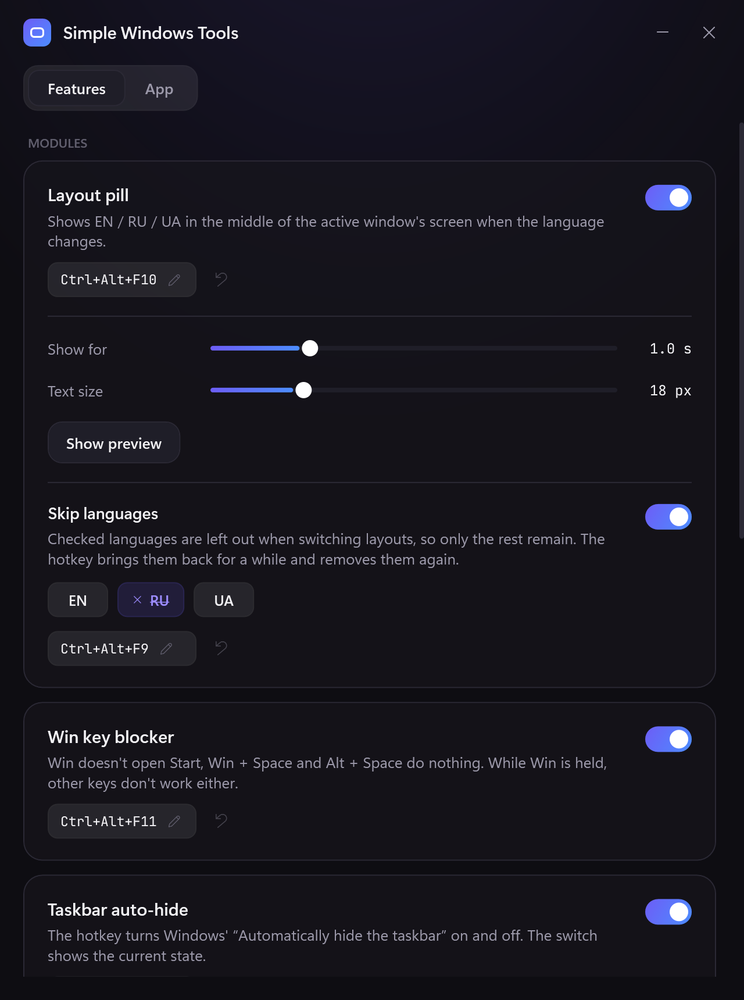
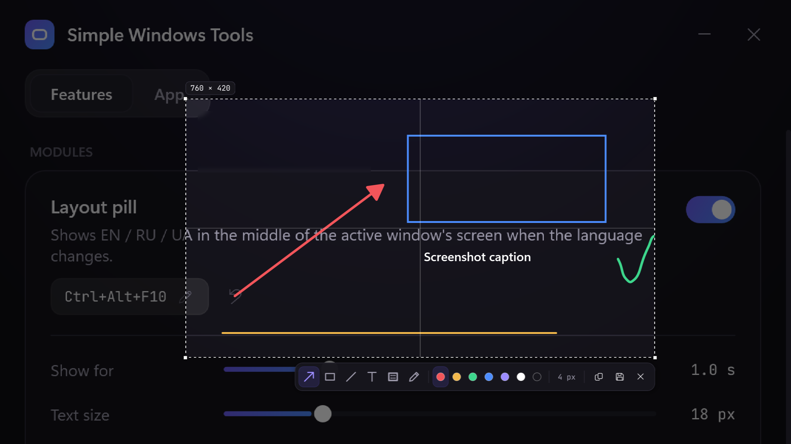
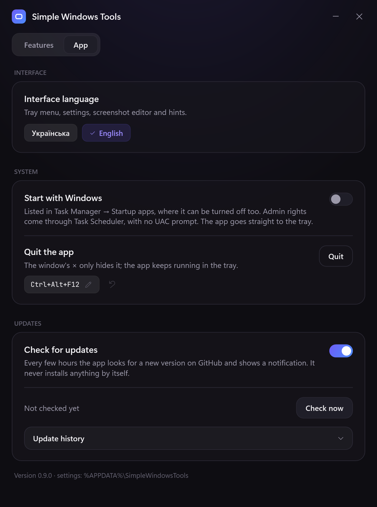
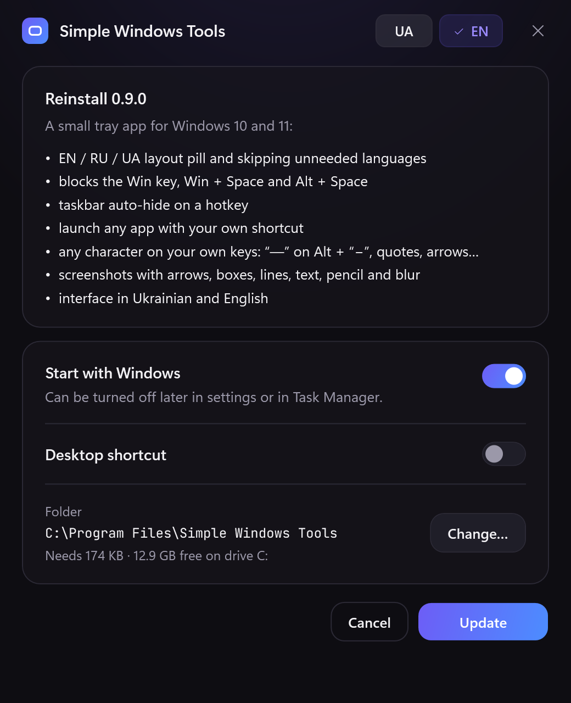

# Simple Windows Tools

A small tray app for Windows 10 and 11 with a handful of everyday helpers: an on-screen keyboard layout
indicator, skipping layouts you rarely use, a Win key blocker, taskbar auto-hide on a hotkey, your own
shortcuts for launching apps and typing any character (the em dash and more) and a quick screenshot editor. Dark interface in
English and Ukrainian; updates itself from this repository.

**[⬇ Download the latest version](https://github.com/AM0SK/SimpleWindowsTools/releases/latest)** — `SimpleWindowsTools-Setup.exe`



## Features

| Feature | What it does | Default hotkey |
| --- | --- | --- |
| **Layout pill** | Shows EN / RU / UA (any installed language) for a moment in the middle of the screen when the keyboard layout changes. | `Ctrl+Alt+F10` on/off |
| **Skip languages** | Chosen layouts are left out when you switch with Alt+Shift / Win+Space. The hotkey brings them back for a while. | `Ctrl+Alt+F9` |
| **Win key blocker** | Win doesn't open Start; Win+Space and Alt+Space do nothing. Handy for games and for people who hit Win by accident. | `Ctrl+Alt+F11` on/off |
| **Taskbar auto-hide** | Turns Windows' “Automatically hide the taskbar” on and off. Works on Windows 10 and 11, for the taskbars on all monitors. | `Ctrl+Alt+F8` |
| **Launch apps** | Your own shortcut for any program, shortcut, file or folder (e.g. Calculator on `Ctrl+Alt+C`). Add as many as you like; **Built-in apps** adds Calculator, Notepad, File Explorer, Task Manager and others in one click. They open with normal user rights, like a double-click. | your choice |
| **Characters** | Your own shortcut for any character, typed in any layout. The em dash “—” is there by default; **Popular characters** adds dashes, quotes, arrows, math signs, currencies and others in one click, anything else can be pasted or typed as a `U+XXXX` code. | `Alt` + `-` for “—”, the rest your choice |
| **Screenshot** | Select an area of the screen, mark it up, then copy or save. | `PrintScreen` |
| **Quit** | Closes the app. | `Ctrl+Alt+F12` |

Every hotkey can be changed: click it in the settings window and press a new combination (↺ resets it).
The app won't let two features, apps or characters share a combination, and warns if another program already holds it.
Open the settings by clicking the tray icon; its right-click menu has the on/off toggles too.

### Screenshot editor



| Keys | Action |
| --- | --- |
| Drag | Select an area. Drag a corner to resize it, a side to move it |
| `1` … `6` | Arrow, rectangle, line, text, blur, pencil — the tool at that place on the toolbar |
| Drag a tool button | Reorder the toolbar (also in the settings); the number keys follow the order |
| `Shift` while drawing | Keeps a line or arrow horizontal / vertical |
| `Shift` + drag | Move an element you already drew |
| Pencil | Freehand drawing; the line is smoothed a little, so there are no sharp corners or jerks |
| Mouse wheel | Line thickness, text size or blur strength of the last element |
| `Ctrl+Z` | Undo |
| `Enter` / `Ctrl+C` | Copy to the clipboard and close |
| `Ctrl+S` | Save as PNG |
| `Esc` | Close |

The last color, thickness, text size, blur strength, tool order and save folder are remembered.

### Layout pill


### Settings: app tab

The second tab has the interface language, start with Windows, and updates with the update history.



## Requirements

- Windows 10 or Windows 11, 64-bit (x64).
- Nothing else: .NET is built into the installer.
- Administrator rights once, during setup. The app runs with admin rights so its keyboard shortcuts also
  work in apps that run as administrator; after setup it starts without a UAC prompt (through Task Scheduler).

## Install

1. Download **`SimpleWindowsTools-Setup.exe`** from [Releases](https://github.com/AM0SK/SimpleWindowsTools/releases/latest).
2. Run it. The installer is not code-signed, so Windows SmartScreen may warn about an unknown publisher:
   click **More info → Run anyway**. Some antivirus tools are wary of any app that uses a keyboard hook;
   the source code is all here.
3. Pick the language (top right), whether to start with Windows and create a desktop shortcut, and the folder
   (default `C:\Program Files\Simple Windows Tools`). Click **Install** and confirm the UAC prompt.
4. The app sits in the tray. Click the icon to open the settings.



Settings are kept in `%APPDATA%\SimpleWindowsTools\settings.json`.

**Uninstall:** Windows Settings → Apps → Simple Windows Tools → Uninstall. Settings are removed too.

## Updates

The app checks GitHub Releases every few hours and shows a Windows notification when a new version is out.
Open the settings → **App** → **Download and install** (or click the notification): it downloads the newest
installer from this repository and runs it, and the installer updates the app in place and starts it again.
Nothing is installed without your click.

You can turn the check off in the settings (it's on by default). The only request it makes is to
`api.github.com` for the latest release of this repository; no data about you or your PC is sent.

## Build from source

Requirements: [.NET 10 SDK](https://dotnet.microsoft.com/download), Windows x64.

```
cd src/SimpleWindowsTools
dotnet build -c Debug
bin/Debug/net10.0-windows/SimpleWindowsTools.exe --selftest report.txt     # logic checks, must be 0 failed
bin/Debug/net10.0-windows/SimpleWindowsTools.exe --render out-dir          # PNGs of the UI
bin/Debug/net10.0-windows/SimpleWindowsTools.exe --render-docs docs/screenshots
dotnet publish -c Release -r win-x64 -p:SetupBuild=true -p:PublishSingleFile=true -o out
```

`out/SimpleWindowsTools.exe` is the installer (rename it to `SimpleWindowsTools-Setup.exe`). Started from
anywhere except its install folder it installs or updates; the installed copy is the app itself.

### Releasing

Bump `<Version>` in `src/SimpleWindowsTools/SimpleWindowsTools.csproj`, add an entry on top of
`src/SimpleWindowsTools/Core/Changelog.cs` (the self-test fails otherwise) and push to `main`.
The [Release workflow](.github/workflows/release.yml) builds the installer and publishes release `vX.Y.Z`
with it; installed copies pick it up and notify their users.

## Tech

C# / .NET 10, WPF for the UI, a WinForms `NotifyIcon` for the tray, a low-level keyboard hook for the
shortcuts.
